# Deep Space Health Systems

An offline-first crew health prototype for NASA Space Apps. The tablet interface uses a dim starfield, transparent header, and straight-edged cards. Record vitals is the primary daily action, followed by grouped review tools and less frequent tools/training. Page titles and content align to the left. Navigation is immediate, with restrained color feedback instead of animated lift or crossfades.

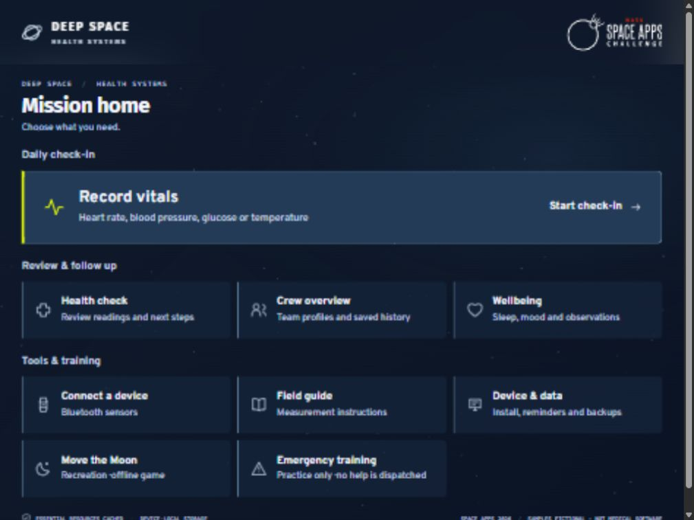

**Prototype:** educational guidance and emergency rehearsals are not clinical diagnosis, flight-approved treatment, or emergency monitoring. Crew-profile health values are labeled demo data. Use fictional readings for demonstrations.

## Run locally

### Requirements

- Node.js 22.18 or newer, npm, and Git.
- Internet for dependency installation and the initial offline preload.
- A current browser. Bluetooth and home-screen installation depend on browser, operating system, and device support.

```sh
git clone https://github.com/dphan-industries/nasa-health.git
cd nasa-health
npm ci
```

No API key, account, database server, or environment file is required for the current app. Move the Moon's exported web assets are included; Expo is not needed to run them.

### Development

```sh
npm run dev -- --port 3001
```

Open [http://127.0.0.1:3001](http://127.0.0.1:3001). Using a separate development port helps avoid interference from a previously cached production version.

### Production and offline testing

```sh
npm run build
npm run start -- --port 3000
```

Open [http://127.0.0.1:3000](http://127.0.0.1:3000). From the main screen, open **Device & data** and wait for **Offline availability → Ready for offline use on this device**. The first preload includes roughly 27 MB of game resources before compression, plus the application, fonts, and background.

Stop the server with **Ctrl+C**. Rebuild after changing production code. If a port is occupied, choose another port in the command and browser URL.

`localhost`, `127.0.0.1`, and different ports are separate origins: each has its own saved records and offline cache. On Windows, use `npm.cmd` if PowerShell blocks `npm.ps1`.

## Current screens

The screenshots below show the current design in a separate local preview. They contain demo content, not personal health records.

### Mission home

**Daily check-in** presents one prominent Record vitals action. **Review & follow up** groups Health check, Crew overview, and Wellbeing. **Tools & training** groups Connect a device, Field guide, Device & data, Move the Moon, and Emergency training. Recreation and training remain secondary to health recording. There is no sidebar or repeated Home/emergency button in the header. The header blends into the starfield and displays the supplied Space Apps logo without a white panel.

### Record vitals

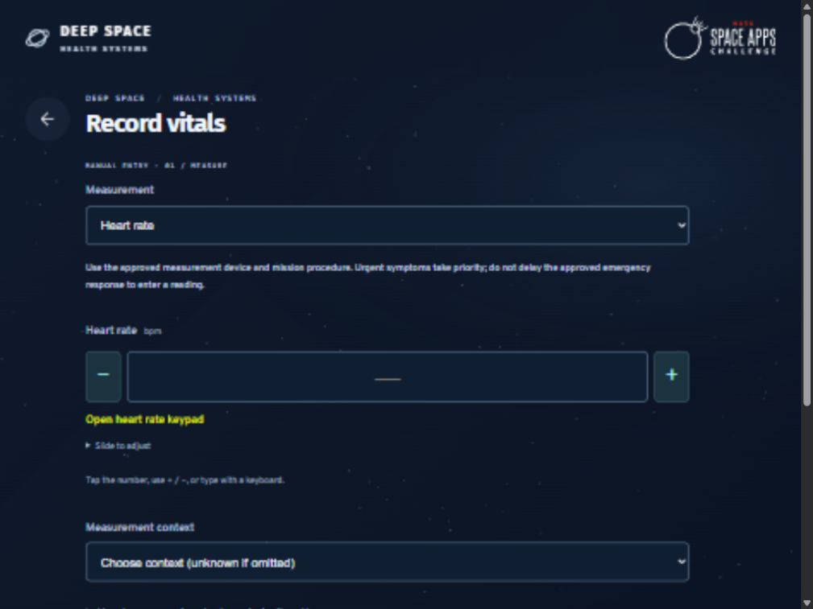

Choose **Heart rate**, **Blood pressure**, **Blood glucose**, or **Body temperature**. The value input appears directly after the measurement selector and a brief safety note. Longer explanations and source-linked instructions are collapsed under How to measure. The left-aligned form supports number buttons, plus/minus controls, a touch keypad, optional sliders, and keyboard entry. Temperature supports decimals; blood pressure has separate systolic and diastolic values.

Select **Review reading**, confirm the value and source, then **Save to this device**. A reviewed value is not saved until that final action. Unsaved entries prompt before navigation discards them.

### Health check

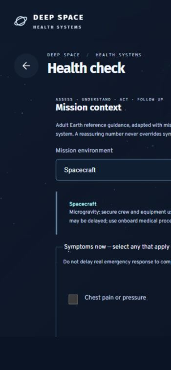

Review recorded indicators, their age and source, educational reference guidance, and next steps. Choose the mission environment, record symptoms, and save follow-up actions. Missing readings remain unknown; starter samples are excluded and sensor simulations require explicit inclusion. Urgent symptoms take priority over displayed numbers.

The screen also explains the five spaceflight hazards and supports a downloadable medical handoff for manual transfer. Guidance cites Earth-based educational sources; it is not validated for spaceflight.

### Crew overview

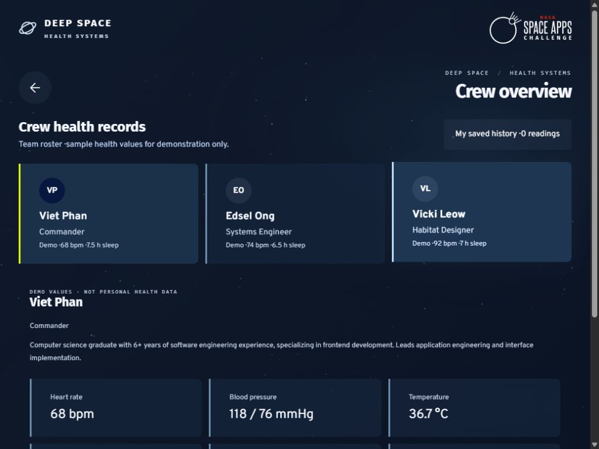

| Member | Project crew title | Background |
| --- | --- | --- |
| Viet Phan | Commander | Computer science graduate; 6+ years of software engineering experience, specializing in frontend development. |
| Edsel Ong | Systems Engineer | Computer science student contributing to application development and engineering. |
| Vicki Leow | Habitat Designer | Art diploma graduate from Singapore; artwork and visual design focused on a welcoming crew environment. |

Select a member to view their profile and **demo** vital signs, sleep, mood, and observations. These titles describe the project crew. Sample health values are not personal medical records or live sensor data. **Saved history** opens this browser's saved readings separately; the app does not synchronize crew devices.

### Saved history

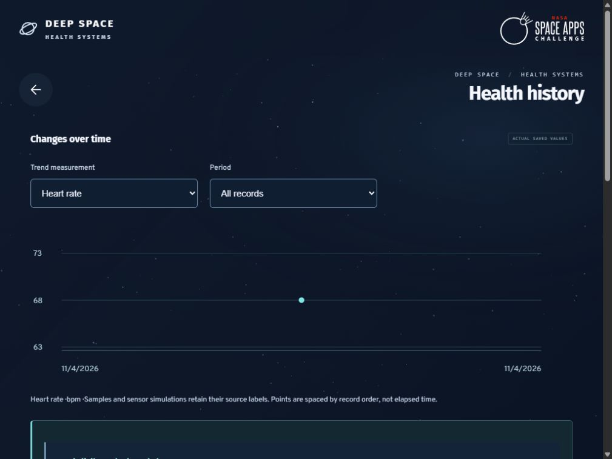

Open **Crew overview → Saved history**. Review timestamps, units, sources, observations, and educational explanations. Charts support metric and time-range selection, and tables retain exact values. Fictional references are labeled. Report import/export transfers records manually between devices; it does not create an online account or automatic synchronization.

### Wellbeing

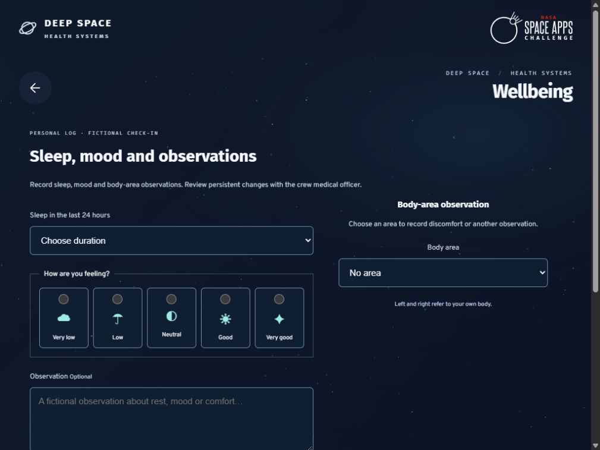

Record sleep duration, mood, and optional notes. A **body-area menu** selects where an observation applies; the human-body illustration has been removed. Left and right refer to the person's own body. Relevant educational information appears after selecting an area.

The expandable daily log includes fluids, meals, aerobic and resistance exercise, dosimeter-transcribed exposure, and habitat notes. Blank entries mean unknown. Saved check-ins appear in the journal. Repeated low mood prompts a crew medical check-in rather than a diagnosis.

### Connect a device

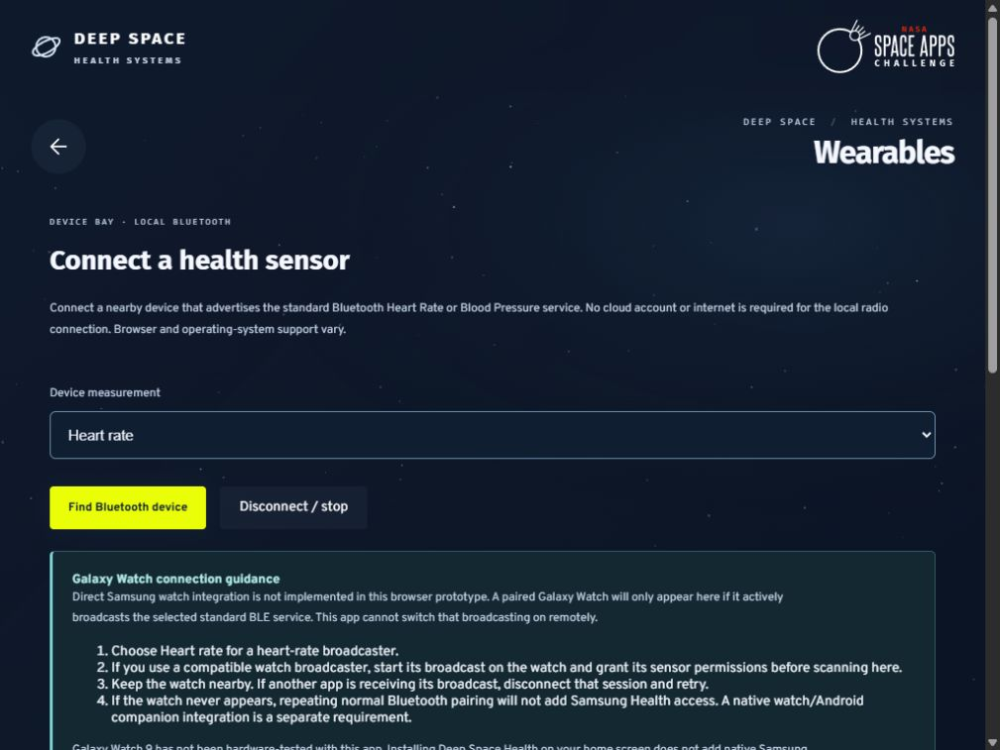

Choose heart rate or blood pressure, then **Find Bluetooth device**. A compatible sensor must broadcast the corresponding standard BLE service. Received readings require review before saving. The fictional simulator remains labeled throughout the workflow.

**This is not a universal smartwatch integration.** Ordinary Samsung/Apple/Garmin phone pairing does not make proprietary health data available to the browser. Galaxy Watch 9 has not been hardware-verified. Native health-platform integrations require separate work. Home-screen installation does not add those capabilities.

### Field guide

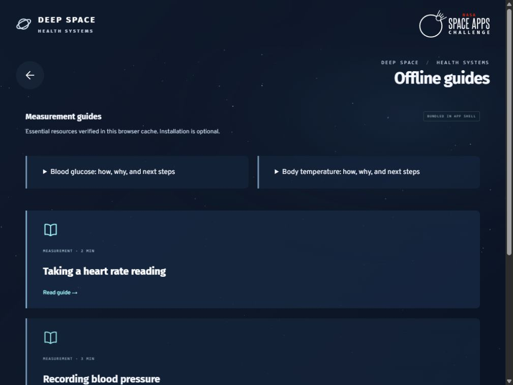

Open the bundled measurement and offline-use guides for step-by-step instructions, units, and explanations. Glucose and temperature guidance is also available. Bundled content works after offline preload; external reference links require connectivity.

### Move the Moon

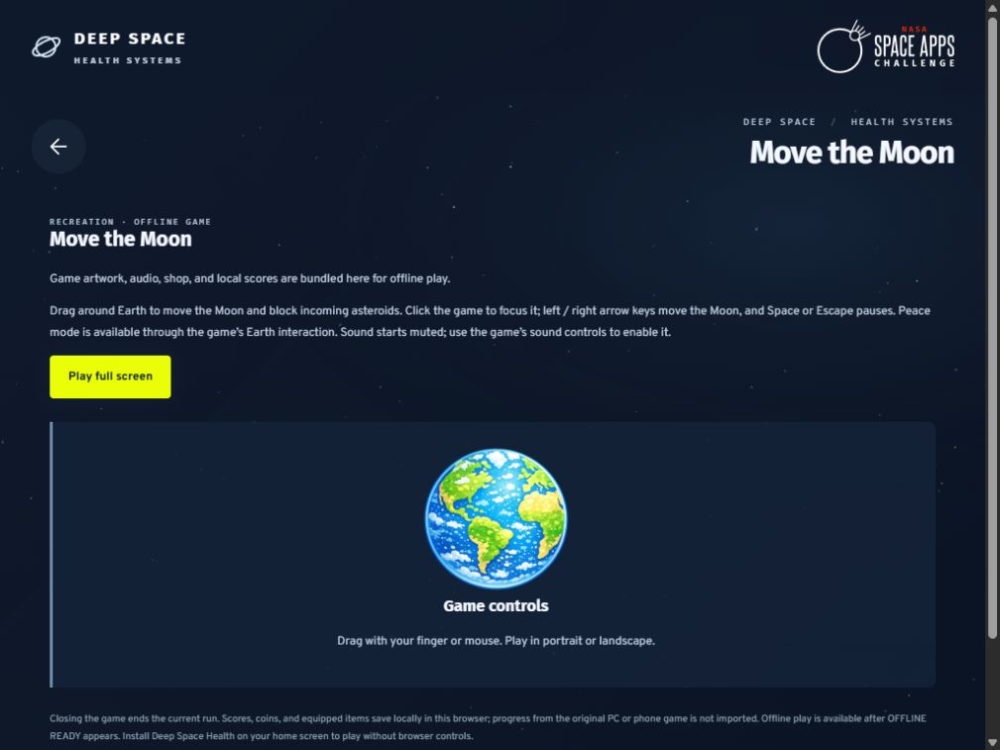

Choose **Play full screen** to open the bundled original game. Drag with a finger or mouse to orbit the Moon and block asteroids. Arrow keys move it; Space/Escape pauses. The game includes its artwork, shop, sound controls, and local scores. Sound starts muted; no ads or account are required.

The player fills the viewport and provides Full screen, Restart, and Close controls. Rotation recenters the arena and pauses an active run. Browser fullscreen support varies; an installed standalone app avoids browser chrome. Closing ends the current run, while scores and cosmetics stay in local browser storage. Original PC/native progress is not imported.

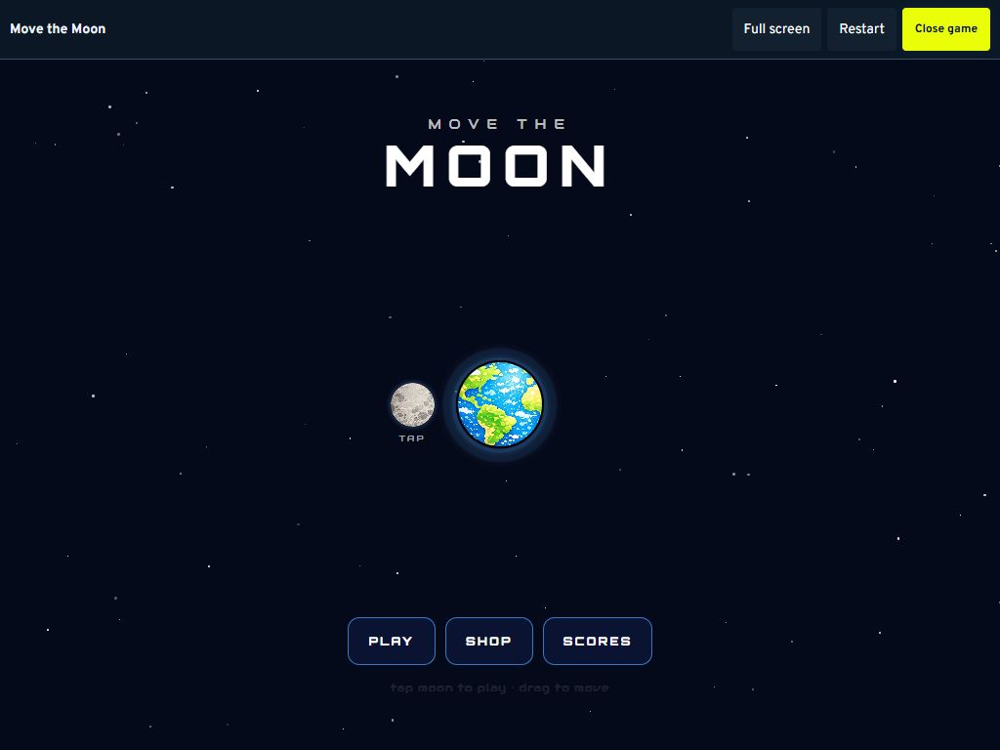

See [game integration and rebuild instructions](docs/MOVE_THE_MOON.md). Earth Room is not part of the current interface.

### Device & data

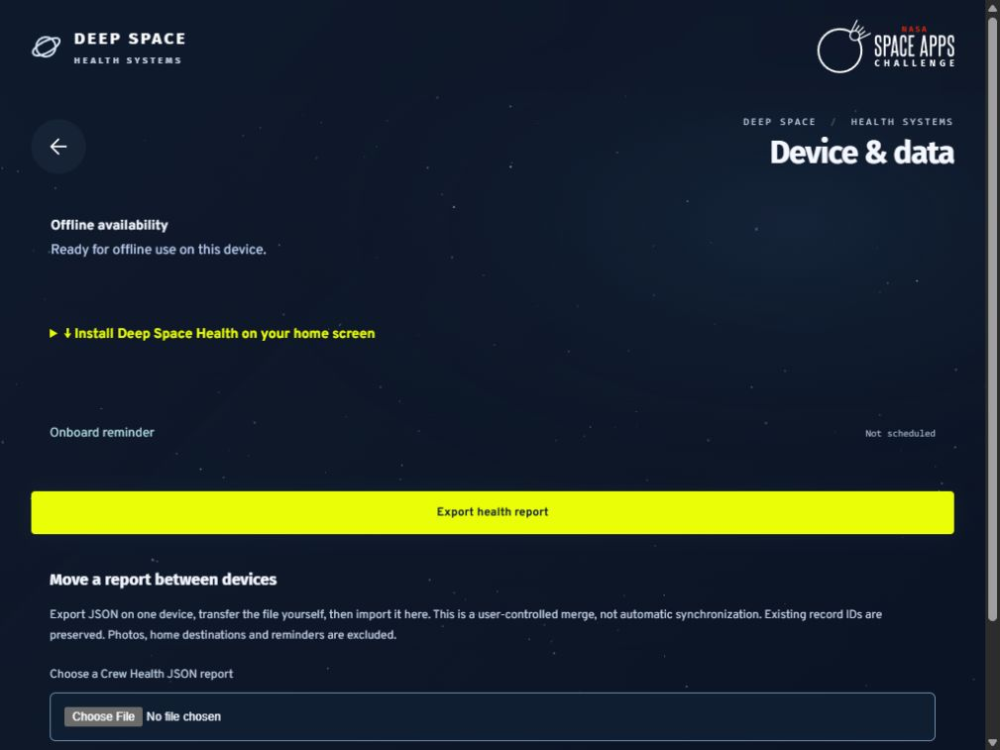

This screen groups **offline availability**, **home-screen installation**, **reminders**, **report export**, and **report import**. Offline status is intentionally absent from page headings.

Install from a supported browser's menu or the displayed instructions. Phones need a reachable HTTPS deployment; a desktop loopback URL does not point to that desktop from a phone. Localhost is suitable for local development. An installed app still requires its first connected preload.

Reminders work while the app is open; browser suspension can prevent delivery. Exported JSON contains local readings, wellbeing entries, and incident/action logs. Imports validate and merge by record ID. Reports are unencrypted and exclude game progress and reminders.

### Emergency training

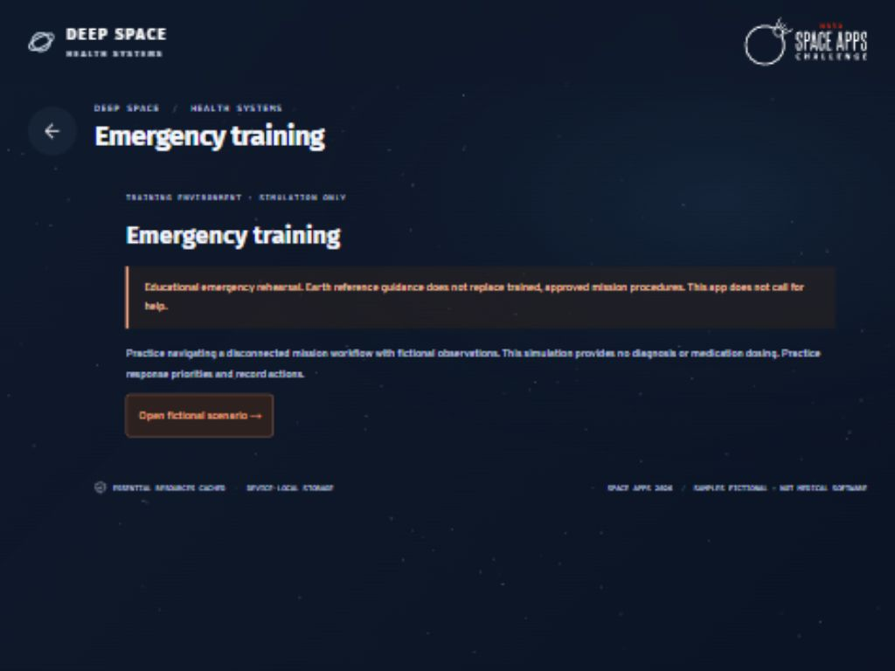

The main-screen tile opens a training workflow for urgent symptoms and habitat scenarios. Guided responsiveness/breathing selections, checklists, observations, and a local incident log support rehearsal. No alert is sent to another person, no treatment is verified, and the app does not dispatch help. Follow approved mission procedures and trained medical direction.

## Offline and storage

The production service worker caches the app, guides, icons, local fonts, starfield, and exported game assets. **Device & data** reports readiness after required cached resources and database availability have been checked. Initial preload and updates require connectivity.

| Feature | Offline behaviour |
| --- | --- |
| Measurements, review, history, wellbeing, and action logs | Local records after preload. |
| Guides, educational reference text, and emergency rehearsal | Bundled content; external links remain online. |
| Move the Moon | Bundled assets and local game saves. |
| Report export/import | Local files; transfer between devices is manual. |
| Compatible BLE sensor | Local radio may work without internet; browser/device support is required. |
| Crew overview | Static team profiles and labeled demonstration values. |
| Live crew synchronization, emergency dispatch, native watch health platforms | Not implemented. |

Health entries use IndexedDB; the game uses its own browser storage. Clearing site data, private browsing, quota limits, or storage eviction can remove records. Export important data yourself. Installation does not make storage permanent or provide mission-grade encryption.

When changing cached assets, update the cache version in [public/sw.js](public/sw.js), rebuild, reconnect, and reload. An older cached screen can appear while a new worker installs. A disconnected device cannot receive an update.

## Development and verification

| Command | Purpose |
| --- | --- |
| `npm ci` | Install locked dependencies. |
| `npm run dev -- --port 3001` | Start development. |
| `npm run build` | Build and type-check production. |
| `npm run start -- --port 3000` | Serve the production build. |
| `npm test` | Run the 25 automated tests. |
| `npm run lint` | Run ESLint. |

The production build and 25 tests passed for the current release. Tests cover storage, migrations, imports, sensor packet parsing, reference assessments, and offline resource/navigation behaviour. Browser checks covered tablet/phone layouts, navigation, crew selection, local saves, and offline reopening. Core palette contrast checks exceed 4.5:1 for text and 3:1 for rails and field boundaries. This is not a complete accessibility certification.

Physical smartwatch connections, all browser/phone combinations, full screen-reader compliance, and operational spaceflight use remain unverified.

### Repeat an offline check

1. Build/start production and wait for readiness in **Device & data**.
2. Save a fictional reading, refresh, and confirm it persists.
3. Disconnect the test device's network and reload with the service worker enabled.
4. Open each main feature and launch the game. Save another fictional reading and wellbeing entry.
5. Refresh and check persistence. Test file transfer separately in another disposable browser profile.
6. Restore connectivity before receiving updates. Never clear a real user's storage to test cache failures.

## Source map and references

| Path | Purpose |
| --- | --- |
| `app/page.tsx` | Main-screen tiles, navigation, measurements, history, and emergency workflow. |
| `app/globals.css` | Shared theme, layout, straight container rails, focus, and motion. |
| `app/components/crew-overview.tsx` | Team profiles and separated demo health values. |
| `app/components/` | Number controls, wellbeing, sensors, guides, installation, transfers, and game wrapper. |
| `lib/storage.ts`, `lib/transfer.ts` | IndexedDB schema, validation, migrations, and report merge. |
| `lib/health.ts`, `lib/bluetooth.ts`, `lib/offline.ts` | Educational assessments, BLE parsing, and offline readiness. |
| `public/brand/`, `public/fonts/` | Supplied logos, static starfield, offline fonts, and font licenses. |
| `public/games/move-the-moon/`, `vendor/move-the-moon/` | Exported game and copied source. |
| `docs/screenshots/current/` | Screenshots of the current interface used above. |

The visual system uses Space Apps typography and supplied official logo colorways, with an independent Deep Space Health Systems project identity. See [branding and licenses](docs/BRANDING.md), [challenge alignment and source register](docs/CHALLENGE_ALIGNMENT.md), and [original requirements](REQUIREMENTS.md). Older numbered screenshots document previous iterations and are not the current interface.
